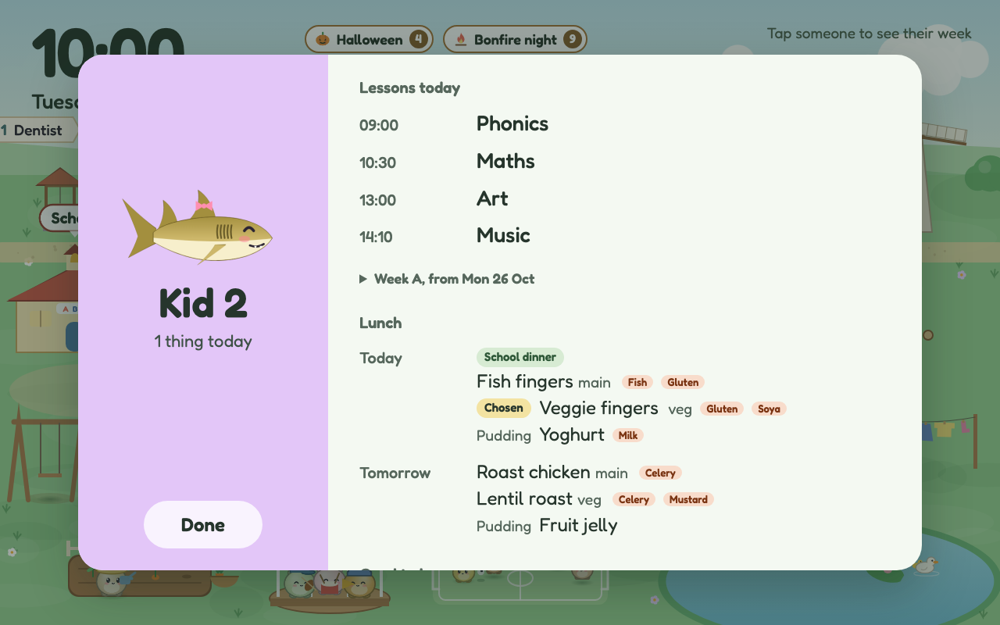
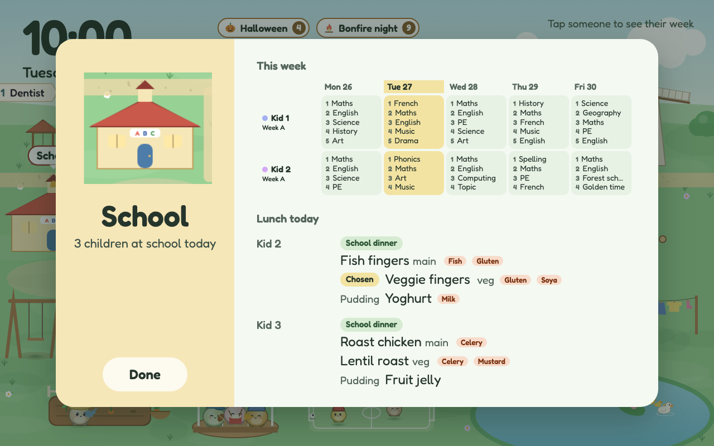

# 08 School data per child

Each child can have a lesson timetable and a school lunch menu, each read from a sensor
attribute. Tap the child and their card shows today's lessons (the next school day's once
today's last lesson has ended, or when there is no school), the week's grid folded under them,
and lunch today and on the next school day with the options, their allergens and whether the
child takes a packed lunch. Tap the school and every child's week sits in one grid, one lane
each, with today's lunches below.

| A child's card | The School card |
|---|---|
|  |  |

```yaml
people:
  - { name: Kid 1, school: true, calendar: calendar.kid_1, timetable: sensor.kid_1_timetable }
  - name: Kid 2
    school: true
    timetable: sensor.kid_2_timetable
    lunch: sensor.kid_2_lunch
    choice: { fri: packed }               # or packed, school, or input_select.kid_2_lunch
  - { name: Kid 3, school: true, lunch: { entity: sensor.kid_3_school, attribute: lunch } }
```

`timetable` and `lunch` are sensor ids. The card reads the `timetable` and `menu` attributes,
or the one you name with `{ entity, attribute }`. An attribute may also be a JSON string.
Leave one out and that section is not on the card. Set one that is missing and the card says
`Timetable unavailable (sensor.kid_1_timetable)` and why in its footer, rather than showing a
day with no lessons.

## The timetable attribute

```json
{
  "weeks": ["A", "B"],
  "anchor": "2026-09-07",
  "week_of": { "2026-11-02": "B", "2026-12-21": null },
  "periods": [
    { "p": 1, "start": "08:50", "end": "09:50" },
    { "p": 2, "start": "09:50", "end": "10:50" },
    { "p": "Reg", "start": "13:20" }
  ],
  "days": {
    "A": { "mon": [{ "p": 1, "subject": "Maths", "room": "M1" }, { "p": 2, "subject": "Art" }] },
    "B": { "mon": [{ "p": 1, "subject": "French", "room": "L2" }], "tue": ["History|H2", "Science"] }
  },
  "closed": ["2026-10-28", { "date": "2026-12-18", "note": "INSET" }]
}
```

- `weeks` names the rotation in order. A one-week timetable is `["A"]` and needs nothing else.
- `anchor` is any day in the first week. The card counts whole weeks from it, so with the
  anchor above, the week of 19 October is A and the week of 26 October is B.
- `week_of` names the week that starts on a Monday, and the count carries on from there. Use
  it when the school breaks the pattern, for example after a half term that does not count.
  `null` is a week off the timetable. Any day of the week works as the key.
- `periods` sets the rows and their times. There can be any number. A lesson whose `p` is not
  listed still shows, after the listed ones.
- `days` maps each week to `mon` to `fri` (full names work too). A lesson is
  `{ p, subject, room }`, with its own `start` and `end` if it does not match its period, or a
  `"Subject|Room"` string, numbered by position.
- `closed` lists days with no school, plain or with a note. The card says
  `No school today (INSET)` and shows the next school day.
- The `end` times decide when a child's card moves on to the next school day: at the end of
  that child's last lesson today, to the minute. A day where no lesson has an end time (a
  period listed without `end`, or a v1.1.0 sensor) moves on at 15:30.

Saturdays and Sundays are always the weekend. A rotation of two or more weeks with no
`anchor` and no `week_of` cannot say which week it is, and the card says so.

## The lunch attributes

```json
{
  "menu": {
    "2026-10-26": {
      "status": "served",
      "options": [
        { "name": "Pasta bake", "kind": "main", "allergens": ["Gluten", "Milk"] },
        { "name": "Bean chilli", "kind": "vegan", "allergens": [] },
        "Jacket potato"
      ],
      "pudding": { "name": "Apple crumble", "allergens": ["Gluten", "Milk"] },
      "choice": "Bean chilli",
      "note": "Harvest lunch"
    },
    "2026-10-27": { "status": "closed", "note": "INSET" },
    "2026-11-02": { "status": "no_menu" }
  },
  "menu_ends": "2026-12-18"
}
```

These are two attributes on the sensor, `menu` and `menu_ends`, or both inside one attribute
named with `{ entity, attribute }`. `status` is `served`, `closed` or `no_menu`; an entry with
options and no status is served. `kind` and `allergens` are shown as given, so use the words
your school prints. A weekday that is not in `menu` reads `Menu not published for this week`,
or `Menu ran out after Fri 18 Dec` once it is past `menu_ends`.

**The choice.** `choice` on the person says packed lunch or school dinner: `packed` or
`school` every day, a weekday map such as `{ mon: school, fri: packed }`, or an entity whose
state says it (an `input_select` with `Packed lunch` and `School dinner` works). A `choice` on
a menu day overrides the config for that day; when it names one of the options, that option
is marked as chosen. A choice entity wins over both, and when it is unavailable the card falls
back and says so in the footer.

## Feeding the sensors

The card does not care how the attributes are made. Four ways that work:

- **A JSON file and a `command_line` sensor.** The simplest for a timetable, which changes
  once a year. Keep the file out of `/config/www/`, which is public.

  ```yaml
  command_line:
    - sensor:
        name: Kid 1 Timetable
        unique_id: kid_1_timetable
        command: "cat /config/school/kid_1_timetable.json"
        value_template: "{{ value_json.timetable.weeks | join(',') }}"
        json_attributes: [timetable]
        scan_interval: 3600
  ```

  The file holds `{ "timetable": { ... } }`. `rest` takes the same `json_attributes` list when
  the file is served from another machine. `scrape` returns one value per sensor, so turn a
  school's web page into the JSON above with a script first.
- **A template sensor that writes the next 14 days.** For a menu printed as a rotation of
  weeks. `homeassistant/configuration.example.yaml` has the whole sensor; the heart of it:

  ```jinja
  
  
    
    
    
      
    
      {% set w = ((d - start).days // 7) % rota | length %}
      
    
  
  {{ ns.m }}
  ```
- **An override helper.** When the school swaps a week, type the letter into an
  `input_text` and have the timetable template add `week_of` for this Monday from it. The
  example config shows the three lines. The lunch `choice` can point straight at an
  `input_select`.
- **Keep large sensors out of the recorder.** Home Assistant does not record attributes over
  16 KB and logs a warning each time. A full two-week timetable or a term of menus can pass
  that, and the history is useless anyway:

  ```yaml
  recorder:
    exclude:
      entities: [sensor.kid_1_timetable, sensor.kid_2_lunch]
  ```

## Coming from v1.1.0

v1.1.0 put one child's timetable and lunch in `sensors.timetable` and `sensors.lunch`, with
`schoolWho` naming the child. Those configs keep working: the card copies each sensor onto
the child `schoolWho` names, and the flat v1.1.0 shapes (`lessons_today` with
`"Subject|Room"` strings, `grid`, `main_today`, `status_today`) still parse. A child's own
`timetable` or `lunch` wins over the copied one. If `schoolWho` names someone who is not in
`people`, the console warns and the School card says which sensor has no owner. To move over,
set `timetable` and `lunch` on the child and delete the two sensors and `schoolWho`.
